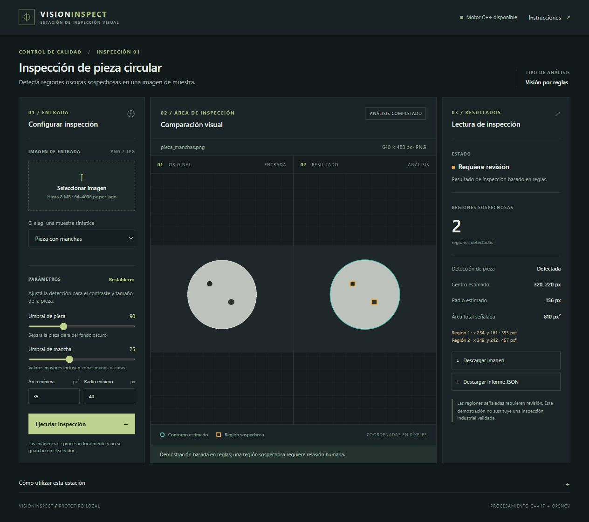

# VisionInspect

Estación local de inspección visual de demostración para una pieza circular clara sobre fondo oscuro. El motor escrito en C++17 usa OpenCV y se expone a Python mediante pybind11; Flask sirve una interfaz HTML/CSS/JavaScript sin enviar imágenes a servicios externos. Busca manchas oscuras en la región interior y marca **regiones sospechosas**, no defectos confirmados.



La captura muestra la aplicación ejecutándose con la muestra sintética `pieza_manchas.png`.

## Alcance y funciones

La aplicación permite elegir una muestra sintética o cargar PNG/JPEG, visualizar original y resultado, ajustar cuatro parámetros y descargar la imagen anotada y un informe JSON. No incluye aprendizaje automático ni detecta interrupciones del borde. El motor necesita iluminación homogénea, una sola pieza clara, fondo oscuro y encuadre completo. No sustituye una inspección industrial validada.

Las imágenes se procesan en memoria, sin guardarse en el servidor. La interfaz ofrece las descargas de manera explícita. El servidor se vincula por defecto a `127.0.0.1:5078`, no tiene autenticación ni está diseñado para redes públicas. El máximo del cuerpo de la solicitud es 8 MB (incluyendo el formulario) y cada dimensión debe estar entre 64 y 4096 píxeles. El original no se modifica. PNG con transparencia se compone sobre fondo oscuro; otros modos se convierten a RGB; se aplica la orientación EXIF antes de la inspección. No se redimensiona: coordenadas y áreas corresponden a la imagen orientada, en píxeles y píxeles cuadrados. El navegador puede ajustar la vista sin modificar el análisis.

## Arquitectura

```text
cpp/include, cpp/src/inspection.cpp  Motor C++ y detección
cpp/src/bindings.cpp                 Enlace pybind11 y NumPy
cpp/tests/                           Prueba nativa CTest
app.py                               Flask, validación, informes y adaptación RGB/BGR
templates/, static/                  Interfaz de inspección
examples/                            Muestras sintéticas
scripts/generate_samples.py          Generador reproducible
tests/                               Pruebas pytest de integración
.github/workflows/                   Compilación y pruebas Linux CI
```

Python decodifica la imagen con Pillow, convierte RGB a BGR y pasa un arreglo NumPy al módulo nativo `vision_engine`. C++ ejecuta OpenCV y devuelve mediciones, cajas y píxeles de la imagen anotada. Python construye el informe y devuelve la imagen al navegador. Si el módulo no puede importarse, la interfaz informa el problema y no simula resultados.

La paleta combina grafito `#12191b`, superficies `#1a2325`, líneas `#303e40` y acento verde `#c0d775`; el ámbar se reserva para regiones que requieren revisión. Las etiquetas de estado acompañan al color.

## Requisitos y compilación en Windows

La compilación verificada en este equipo usó Python 3.14.10 UCRT64, GCC 16.2, CMake 4.4.5, OpenCV 5.0.0 y pybind11 3.1.0. La alternativa MSVC y los comandos de Linux/macOS no se ejecutaron en este equipo.

Se necesita Python de 64 bits, un compilador C++17 compatible con la instalación de OpenCV, CMake 3.20 o posterior, Ninja o un generador equivalente, OpenCV **C++** (cabeceras y bibliotecas), pybind11 y NumPy. `pip install opencv-python` por sí solo **no** instala las bibliotecas C++ necesarias. El compilador, OpenCV y Python deben tener arquitecturas y ABI compatibles.

### Opción Visual Studio / OpenCV oficial

1. Instalá Visual Studio Build Tools con la carga de trabajo «Desarrollo para el escritorio con C++» y Windows SDK. Instalá CMake o usá el incluido con Visual Studio.
2. Instalá una distribución de OpenCV C++ compatible con MSVC. Identificá la carpeta que contiene `OpenCVConfig.cmake` y el directorio de sus DLL.
3. En PowerShell, desde esta carpeta:

```powershell
py -3.11 -m venv .venv
.\.venv\Scripts\python.exe -m pip install -r requirements.txt pybind11
$env:OpenCV_DIR = 'C:\ruta\a\opencv\build\x64\vc16\lib' # ajustar a la instalación
$env:PATH = 'C:\ruta\a\opencv\build\x64\vc16\bin;' + $env:PATH
$pybind = & .\.venv\Scripts\python.exe -m pybind11 --cmakedir
cmake -S . -B build -A x64 -DOpenCV_DIR="$env:OpenCV_DIR" -Dpybind11_DIR="$pybind" -DPython_EXECUTABLE="$PWD\.venv\Scripts\python.exe"
cmake --build build --config Release
ctest --test-dir build -C Release --output-on-failure
```

En generadores multiconfiguración el módulo puede generarse en `build/Release`; copiá el archivo `vision_engine*.pyd` a `build/` o agregá `build/Release` a `PYTHONPATH`. En la terminal de ejecución deben estar disponibles las DLL de OpenCV. Las rutas son ejemplos, no credenciales ni ubicaciones garantizadas.

### Alternativa MSYS2 UCRT64

Instalá [MSYS2](https://www.msys2.org/) y abrí su terminal UCRT64. Actualizá el sistema según la guía de MSYS2 y luego instalá:

```bash
pacman -S --needed mingw-w64-ucrt-x86_64-gcc mingw-w64-ucrt-x86_64-cmake mingw-w64-ucrt-x86_64-ninja mingw-w64-ucrt-x86_64-opencv mingw-w64-ucrt-x86_64-python mingw-w64-ucrt-x86_64-pybind11 mingw-w64-ucrt-x86_64-python-numpy mingw-w64-ucrt-x86_64-python-flask mingw-w64-ucrt-x86_64-python-pillow mingw-w64-ucrt-x86_64-python-pytest
cd /c/Users/danny/Desktop/6sixP/VisionInspect  # adaptá tu usuario y ruta
python scripts/generate_samples.py
cmake -S . -B build -G Ninja -DCMAKE_BUILD_TYPE=Debug
cmake --build build
ctest --test-dir build --output-on-failure
PYTHONPATH=build python -c 'import vision_engine; print(vision_engine.__version__)'
python -m pytest -q
python app.py
```

Usá el Python UCRT64 de MSYS2 para compilar y ejecutar ese módulo; no lo mezcles con el Python independiente de Windows. La instalación puede ocupar varios GB. Las instrucciones MSVC y macOS/Linux son orientativas si no aparecen como verificadas en la entrega; las dependencias cambian con el sistema.

### Ejecutar la compilación ya preparada en este equipo

Se preparó un entorno MSYS2 **local** en la carpeta de trabajo de esta sesión, sin instalarlo globalmente. Desde PowerShell, mientras se conserve esa carpeta:

```powershell
cd "$env:USERPROFILE\Desktop\6sixP\VisionInspect"
$tools = "$env:USERPROFILE\Documents\Codex\2026-11-02\an\work\vision-tools\msys64\ucrt64\bin"
$env:PATH = "$tools;$env:PATH"
& "$tools\python.exe" -c "import app; print('Motor disponible:', app.vision_engine is not None)"
& "$tools\python.exe" app.py
```

Ese entorno fue preparado para esta demostración con OpenCV y sus bibliotecas necesarias para el motor; si se elimina o se mueve, instalá MSYS2 de forma normal y recompilá siguiendo la sección anterior. No uses `.venv` de Python 3.11 con el módulo compilado para Python 3.14 UCRT64.

## Linux / macOS

En Ubuntu, instalá `build-essential cmake ninja-build libopencv-dev python3-dev`; en macOS, herramientas de Xcode, CMake y OpenCV de Homebrew. Después creá un entorno virtual, ejecutá `pip install -r requirements.txt pybind11` y compilá con:

```bash
cmake -S . -B build -G Ninja -DCMAKE_BUILD_TYPE=Debug -Dpybind11_DIR="$(python -m pybind11 --cmakedir)"
cmake --build build
ctest --test-dir build --output-on-failure
PYTHONPATH=build python -c 'import vision_engine; print(vision_engine.__version__)'
python -m pytest -q
python app.py
```

Si CMake no encuentra OpenCV, configurá `OpenCV_DIR` para la instalación local. El flujo de GitHub Actions utiliza Ubuntu y sus paquetes de OpenCV; no se publica ni ejecuta hasta que exista un repositorio remoto.

## Uso y muestras

Abrí `http://127.0.0.1:5078`. Elegí una muestra o archivo y pulsá **Ejecutar inspección**. Ajustá umbrales y volvé a ejecutar; cambiar un parámetro invalida el resultado anterior. **Restablecer** devuelve los valores iniciales. La imagen y el informe JSON se descargan desde el panel de resultados.

`python scripts/generate_samples.py` crea tres imágenes sintéticas de 640 × 480: `pieza_limpia.png` contiene una pieza sin manchas, `pieza_manchas.png` dos manchas oscuras y `sin_pieza.png` un rectángulo que no debe aceptarse como círculo. Estas imágenes no representan variación real de fábricas ni proporcionan una evaluación de precisión industrial.

## Algoritmo y parámetros

C++ convierte BGR a gris, aplica desenfoque gaussiano, umbraliza la pieza clara, cierra pequeñas interrupciones y toma el contorno externo mayor. Rechaza candidatos por radio mínimo, circularidad, proporción de área respecto al círculo envolvente y encuadre. La zona de búsqueda de manchas es un disco interior de 82 % del radio; se umbralizan píxeles oscuros y se filtran contornos por área. El contorno estimado aparece en verde azulado y las cajas sospechosas en ámbar. No detecta defectos fuera de esa región ni distingue sombras de manchas.

- **Umbral de pieza** (30–220): separa la pieza clara del fondo.
- **Umbral de mancha** (0–200): píxeles más oscuros que el valor son candidatos; subirlo aumenta la sensibilidad.
- **Área mínima** (1–100000 px²): descarta regiones pequeñas.
- **Radio mínimo** (10–2000 px): descarta objetos demasiado pequeños.

El JSON contiene fecha UTC, nombre, dimensiones y formato, parámetros, versión del motor, detección, centro, radio, regiones con cajas y área, y limitaciones. No hay calibración a unidades físicas.

## Verificación y límites

`ctest` ejercita el motor nativo. `pytest` cubre módulo, muestras, efectos de parámetros, archivos inválidos, transparencia y motor ausente. Se deben ejecutar con el mismo Python y las mismas DLL que compilaron el módulo. Se verificaron el estado inicial, motor no disponible, selección de muestra, pieza sin manchas, dos manchas, pieza no detectada, cambio y restauración de parámetros y las descargas PNG/JSON. Se revisó visualmente en escritorio y en una ventana de 390 × 844 píxeles. Los resultados usan imágenes sintéticas, no una validación industrial.

Visión por reglas aplica umbrales programados; no aprende de ejemplos. Un futuro detector de aprendizaje automático requeriría imágenes con licencia y etiquetas confiables, división por pieza/lote, evaluación en datos nunca vistos, métricas y análisis de iluminación y errores. No se afirma ninguna tasa de precisión.

## Problemas frecuentes

- **Motor no disponible:** compilá con la misma versión y arquitectura de Python; revisá `PYTHONPATH`, DLL de OpenCV y dependencias del compilador. La aplicación no recurre a un motor simulado.
- **OpenCV no encontrado:** configurá `OpenCV_DIR` hacia `OpenCVConfig.cmake`; una rueda Python de OpenCV no basta.
- **Pieza no detectada:** verificá fondo oscuro, iluminación homogénea, círculo completo, radio mínimo y umbral de pieza. La demo no admite escenarios arbitrarios.
- **Puerto ocupado:** en PowerShell usá `$env:PORT='5080'` antes de `python app.py`.

## Guion para entrevista

Mostrá la muestra limpia y luego la de manchas, explicá cómo la ROI y el filtro de área afectan el resultado y cambiá el área mínima para comprobarlo. Mostrá el JSON y señalá que las unidades son píxeles, que C++ realiza el procesamiento a través de pybind11 y que los datos sintéticos no validan el rendimiento industrial.
